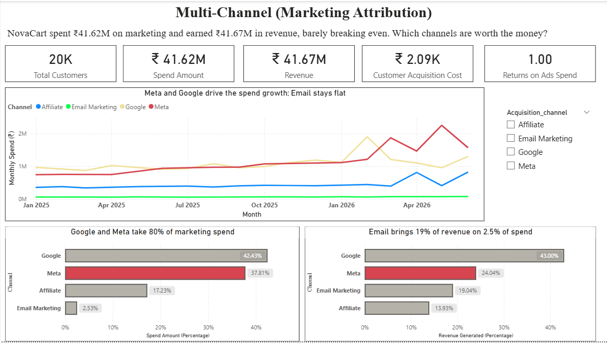
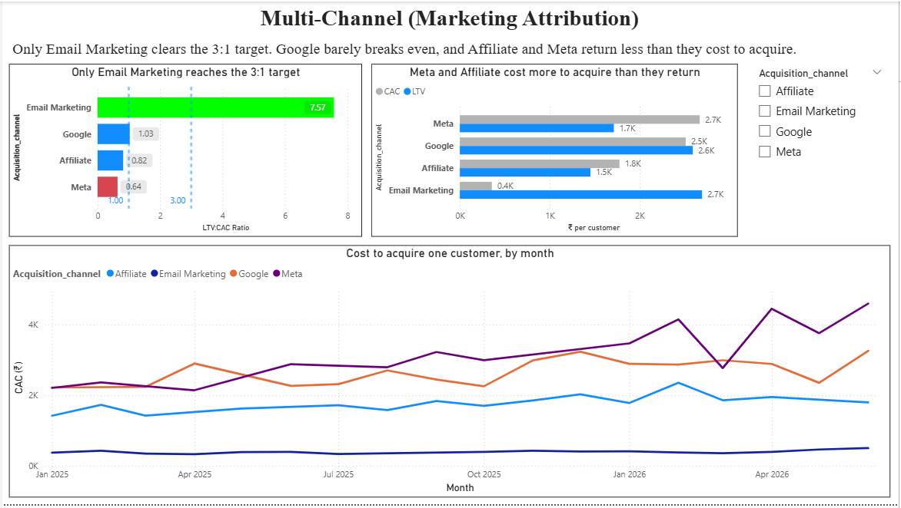
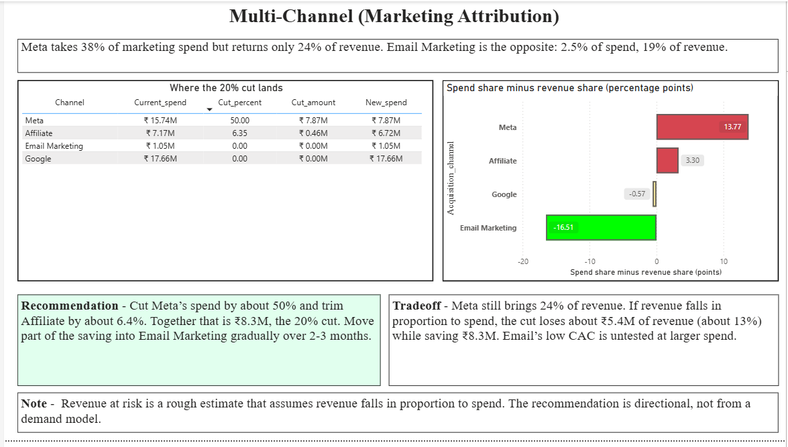

# Multi-Channel Marketing Attribution: Where Should NovaCart Cut 20% of Its Marketing Budget?

**Tools:** Python (pandas, NumPy, Matplotlib, Seaborn) · MySQL · Jupyter · Power BI

An end-to-end analysis of 18 months of customer, order and marketing-spend data. It starts with messy raw tables and ends with a channel-level recommendation and a 3-page Power BI dashboard.



---

## Summary: What I Found

NovaCart spent far more on marketing but earned back much less. I worked out which channels are worth the money and which are not.

- **Spending grew much faster than revenue.** In April to June 2026, spend was up 160.8% compared with the same months a year earlier, while revenue was down 1.3%.
- **Email Marketing is the only clearly healthy channel.** Each customer it acquires brings in about ₹7.57 of revenue in the first year for every ₹1 spent to acquire them. It gets only 2.5% of the budget but generates 19.0% of the revenue.
- **Meta is the weakest channel.** It brings back only about ₹0.64 for every ₹1 spent, and takes 37.8% of the budget for 24.0% of the revenue.
- **Recommendation:** cut Meta's budget by about 50% and trim Affiliate by about 6.4%. Together that is about ₹8.3M, exactly 20% of total spend. Move part of the saving into Email gradually.

**Key terms used below**
- **CAC (Customer Acquisition Cost):** how much it costs to win one new customer.
- **LTV (Lifetime Value):** how much revenue one customer brings in during their first year (365 days).
- **LTV:CAC ratio:** LTV divided by CAC. Above 3 is healthy, between 1 and 3 is weak, and below 1 means the channel costs more than it brings back.

---

## The Business Problem

NovaCart increased marketing spend by 40% year over year across four channels (Google Ads, Meta, Affiliate, Email), but revenue growth only kept pace at 12%. Finance flagged this gap ahead of the Q4 board meeting. The analysis asks which channels acquire customers who generate long-term value, and which generate low-value transactions that do not justify their acquisition cost. It then recommends how the budget should be reallocated.

### Objectives

1. Calculate Customer Acquisition Cost (CAC) by channel, month over month, across the 18-month period.
2. Calculate Customer Lifetime Value (LTV) by channel, using a defined time horizon.
3. Compute the LTV:CAC ratio per channel and flag channels below the 3:1 target (or below 1:1, where a channel loses money outright).
4. Assess whether the current budget allocation matches where profitable, retained customers actually come from.
5. Recommend where a 20% budget cut should land next quarter with the least damage to long-term revenue, including the tradeoff.

---

## What I Did

### 1. Data cleaning (`data_cleaning.ipynb`)

Raw data was loaded from three MySQL staging tables (`customers_raw`, `marketing_spend_raw`, `orders_raw`) and cleaned with pandas.

| Table | Raw rows | Issues found and fixed |
|---|---|---|
| Customers | 20,300 | 287 duplicate rows and 13 duplicate customer IDs removed; **21 spellings of channel names** (e.g. "FB", "facebook/instagram", "google ads ", "E-mail") mapped to 4 channels; mixed date formats standardised |
| Marketing spend | 73 | 3 duplicates removed; 18 channel spellings mapped to 4; amounts like "₹1,080,083" converted to numbers; mixed month formats standardised |
| Orders | 36,417 | 361 duplicate rows removed; currency symbols and separators stripped; mixed date formats standardised; ~1,082 missing amounts filled with the median (₹1,218) because the data is heavily right-skewed (skewness 13.9); **549 extreme outliers (up to ₹506,254) removed with the IQR method** after reviewing them |

In the EDA notebook I also removed rows whose dates fell outside the known Jan 2025 to Jun 2026 window (79 customers, 1,029 orders, 4 marketing rows). Those came from ambiguous date formats.

**Analysis dataset:** 19,921 customers, 34,478 orders and 4 channels, covering Jan 2025 to Jun 2026.

### 2. Analysis (`eda.ipynb`)

- **CAC:** total spend divided by customers acquired, per channel. A separate monthly table drives the CAC trend chart.
- **LTV:** average revenue per customer within 365 days of signup.
- **LTV:CAC:** flagged as *Healthy* (above 3:1), *Weak/Unsustainable* (1:1 to 3:1) or *Losing Money* (below 1:1).
- **Budget allocation:** each channel's share of spend compared with its share of revenue.
- **Testing the brief's claim:** the brief states spend +40% and revenue +12%. I tested it directly on the data. Those exact figures could not be reproduced, so I compared the same quarters one year apart, in total and by channel.
- **Cut plan:** a 20% cut table with an estimate of revenue at risk.

### 3. A bug I found in my own work

My first CAC calculation merged monthly customer counts with monthly spend, and the merge silently dropped customers in months with no matching spend row. Email's customer count came out at 2,640 instead of 2,959 (and Meta lost 992 customers). I noticed that Power BI and the notebook disagreed, traced it to the merge, and recalculated CAC from channel totals. Every ratio in this README uses the corrected method.

### 4. Dashboard (`dashboard/multi_channel.pbix`)

A 3-page Power BI report with a Channel slicer that filters every page.

| Page | Question it answers |
|---|---|
| 1. The problem | How much was spent vs earned? Where does the money go, and how did spend and revenue move month by month? |
| 2. Channel efficiency | Which channels earn back more than they cost to acquire a customer? (LTV:CAC against the 1:1 and 3:1 lines, LTV vs CAC, monthly CAC trend) |
| 3. Where to cut | Which channels are over- or under-funded? What does the 20% cut look like in rupees? |




The data model uses a small `Channels` table linked to the customer and marketing tables, so one channel click filters spend, customers and revenue together. Orders from customers missing in the customer table are excluded from the dashboard, to match the notebook.

---

## Key Findings

### Channel efficiency

| Channel | CAC | LTV (365 days) | LTV:CAC | Status |
|---|---|---|---|---|
| Email Marketing | ₹356 | ₹2,695 | **7.57** | Healthy |
| Google | ₹2,513 | ₹2,592 | 1.03 | Weak / Unsustainable |
| Affiliate | ₹1,776 | ₹1,453 | 0.82 | Losing money |
| Meta | ₹2,669 | ₹1,713 | **0.64** | Losing money |

Email customers also order most often (2.08 orders per customer, against 1.81 for Google, 1.60 for Affiliate and 1.55 for Meta).

### Budget allocation vs value returned

| Channel | Share of spend | Share of revenue | Gap (points) |
|---|---|---|---|
| Meta | 37.81% | 24.04% | **+13.77** (overfunded) |
| Affiliate | 17.23% | 13.93% | +3.30 |
| Google | 42.43% | 43.00% | -0.57 (matched) |
| Email Marketing | 2.53% | 19.04% | **-16.51** (underfunded) |

### Spend vs revenue, year on year

| Same quarter, one year apart | Spend growth | Revenue growth |
|---|---|---|
| Q1 2026 vs Q1 2025 | +115.5% | +38.0% |
| Q2 2026 vs Q2 2025 | +160.8% | -1.3% |

Spend growth accelerated while revenue growth stalled. By channel in Q2: **Meta spend +214% with revenue -25%**; Google +74% spend with +8% revenue; Email +20% spend with +16% revenue.

### Recommendation

| Channel | Current spend | Cut | Cut amount | New spend |
|---|---|---|---|---|
| Meta | ₹15.74M | 50% | ₹7.87M | ₹7.87M |
| Affiliate | ₹7.17M | 6.35% | ₹0.46M | ₹6.72M |
| Google | ₹17.66M | 0% | 0 | ₹17.66M |
| Email Marketing | ₹1.05M | 0% | 0 | ₹1.05M |
| **Total** | **₹41.62M** | | **₹8.32M (20.0%)** | **₹33.30M** |

**Why Meta:** it has the worst LTV:CAC, the largest spend-versus-revenue gap, and the weakest quarter-on-quarter trend. Google is not cut because its spend and revenue shares match, so its problem is general efficiency and not misallocation.

**Tradeoff:** Meta still brings 24% of revenue, so cutting it entirely would hurt. If revenue falls in proportion to spend, the cut costs about ₹5.4M of revenue (12.9%) while saving ₹8.3M. Email's low CAC has not been tested at larger spend, so extra budget should move into it gradually over 2 to 3 months.

---

## Assumptions and Limitations

- **Revenue-based LTV.** There is no margin data, so LTV:CAC measures revenue efficiency and not profit. Google's 1.03 would fall below break-even once product costs are included.
- **365-day LTV window.** Customers acquired late in the period have had less time to order, which understates their LTV. LTV is also averaged over customers who ordered at least once, which pushes it the other way.
- **The 40% / 12% figures from the brief could not be reproduced** from this data. The direction matches (spend grew much faster than revenue), but the gap in this dataset is larger.
- **Date handling.** Raw dates came in mixed formats (day-first, month-first, ISO). Rows that parsed outside the Jan 2025 to Jun 2026 window were dropped, and some ambiguous dates inside the window may sit in the wrong month.
- **Known issue to be fixed.** Marketing month labels such as "Aug-25" are read by `dateutil` as the 25th of the *current* year, so a few 2025 spend months were probably placed outside the window and dropped. Total spend, CAC and the ratios may therefore shift slightly when this is fixed. The direction of the findings should hold, but Google's 1.03 is close enough to break-even that it could cross below 1.0.
- **Revenue at risk is a rough estimate.** It assumes revenue falls in proportion to spend. The cut size is reasoned from the metrics above, not from a demand model.
- **Orders from customers missing in the customer table** (about ₹0.46M) cannot be attributed to a channel and are excluded.

---

## Repository Structure

```
marketing-attribution-data-analysis/
├── dashboard/
│   ├── screenshots/
│   │   ├── page1.png
│   │   ├── page2.png
│   │   └── page3.png
│   └── multi_channel.pbix
├── novacart_data/
│   ├── processed/
│   │   ├── customer.csv
│   │   ├── marketing.csv
│   │   └── order.csv
│   └── raw/
│       ├── customers.csv
│       ├── marketing_spend.csv
│       └── orders.csv
├── notebooks/
│   ├── data_clean.ipynb
│   └── eda.ipynb
├── sql/
│   └── load_raw_tables.sql
├── .gitignore
├── README.md
└── requirements.txt
```

## How to Run

   1. Install the libraries: `pip install -r requirements.txt`
   2. Load the raw tables into a local MySQL database named `novacart_staging` (see `sql/load_raw_tables.sql`) and set the password in an environment variable (`HR_DB_PASSWORD`). Never hard-code it in the notebook.
   3. Run `notebooks/data_clean.ipynb` to create `customer.csv`, `marketing.csv` and `order.csv`.
   4. Run `notebooks/eda.ipynb`.
   5. Open `dashboard/multi_channel.pbix` in Power BI Desktop and refresh the data from the cleaned CSVs.

---

**Author:** Ranak Maity · [GitHub](https://github.com/Ranak5) · [LinkedIn](https://www.linkedin.com/in/ranak-maity/)
